```{r setup}
library(readr)
library(dplyr)
library(htmltools)
```

Adamsville started as a farm crossroads outside Atlanta. The city's postwar growth absorbed it, highway building and racial change reshaped it, and in recent decades it has received relatively little investment.

## A farm crossroads

Before it was Adamsville, the settlement was a crossroads called Lick Skillet, on the road from the Chattahoochee River ferries into Atlanta. Reports from the July 1864 Battle of Ezra Church refer to "Lick Skillet Road," and a 1958 state historical marker notes that the crossroads settlement is "now known as Adamsville" (Georgia Historical Society, 1958). The name changed in the 1870s, after a Masonic lodge founded by George W. Adams, and became official in 1906 (City of Atlanta & TSW, 2020, p. 16). The Adamsville Civic Club's 1955 history recalls that the families of old Lick Skillet, among them the Fains, Howells, Waites and Greens, were still prominent, and that Adams gave his name to "the road junction and the few stores" (Adamsville Civic Club, 1955, p. 3).

Black families also lived in the area from early on. In 1907 a congregation started the Bethlehem Church School, which Atlanta Public Schools describes as the first school for African American students in the Adamsville–Boulder Park community, later renamed L. P. Miles Elementary (Atlanta Public Schools, n.d.). The Civic Club's 1955 report, written by the white civic organization that dominated local planning, does not mention these Black families at all, which says something about who counted as "the community" when planning began.

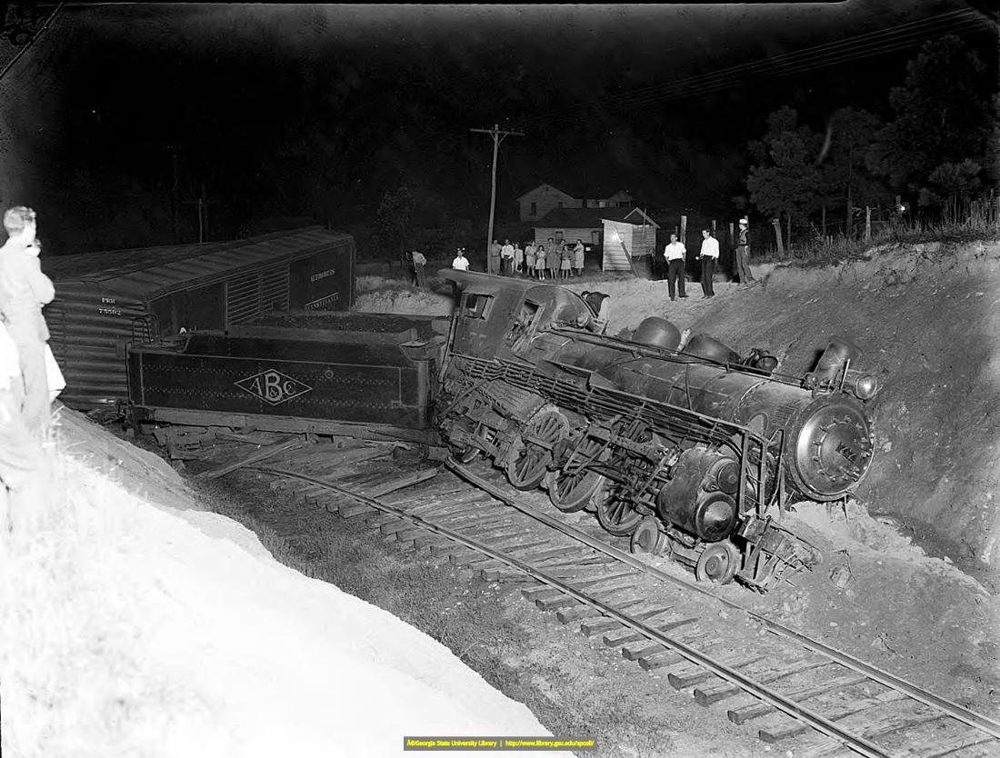{fig-alt="A derailed steam locomotive tilted on the tracks in a cut, with onlookers on the bank at night."}

## The 1950s: a neighborhood that planned for itself

Growth came quickly after World War II. In the Civic Club's words, "in 1951, when we were annexed by Atlanta, we became aware of how different the area was becoming. We suddenly found ourselves in the path of Atlanta's enormous urban growth" (Adamsville Civic Club, 1955, p. 3). That was the year the state approved Mayor Hartsfield's Plan of Improvement, which tripled the city's area in 1952 (Hartsfield, 1952). Annexation came in stages: in 1966 the General Assembly authorized a referendum to bring the remaining unincorporated Adamsville area into the city on January 1, 1967 (Atlanta Board of Aldermen, 1966).

Photographs taken on Gordon Road, the old road west through Adamsville that is now Martin Luther King Jr. Drive, show some of this postwar change, including new brick houses on cleared lots, a lumber yard supplying the building boom, and rail crews laying track for the industry growing to the west. The negative envelopes record only "Gordon Road," so the exact locations are not known.

::: {layout-ncol=3}
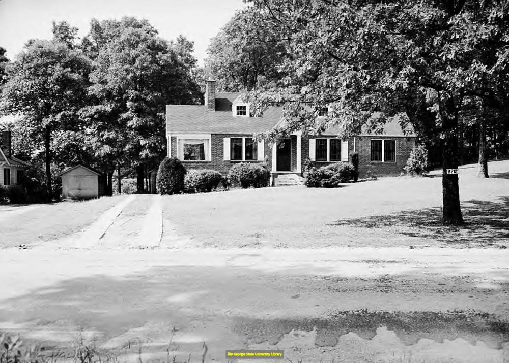

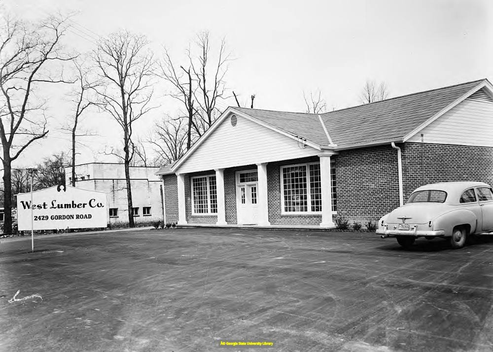

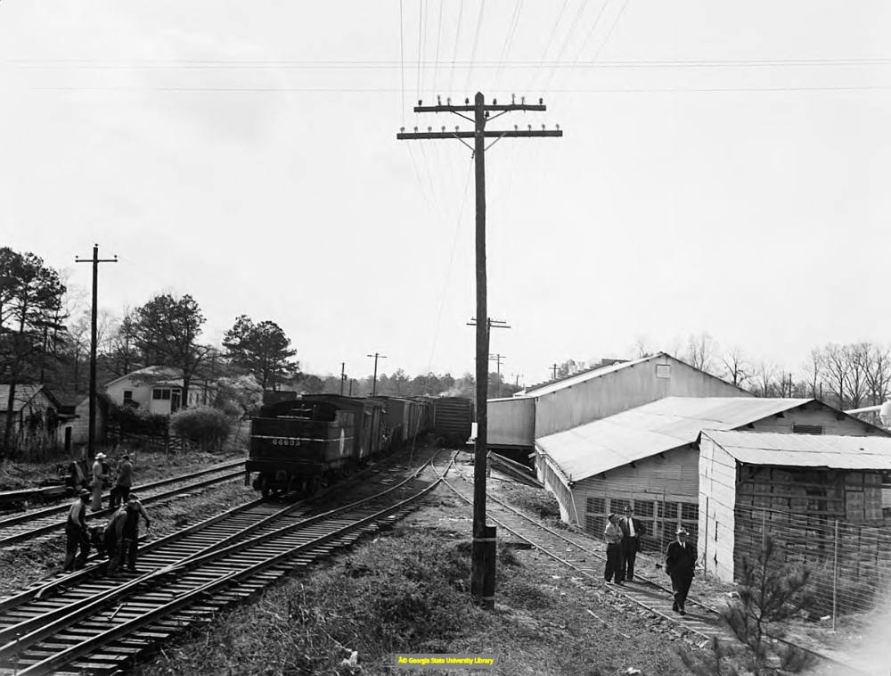
:::

::: {layout="[[1,1]]"}
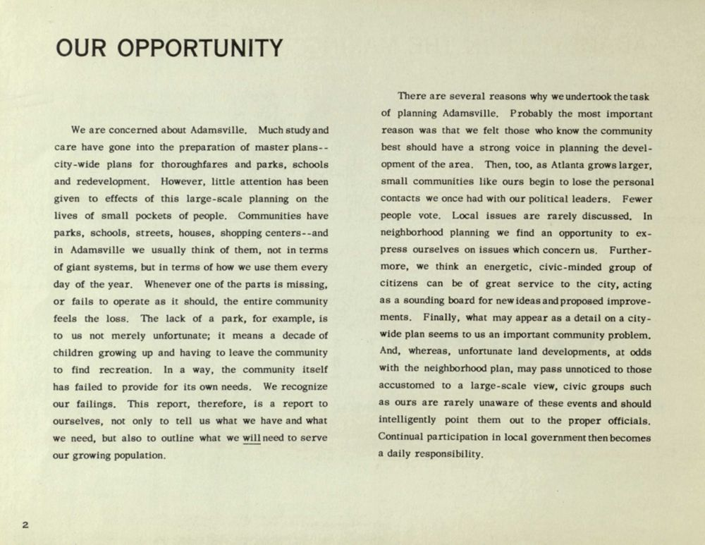

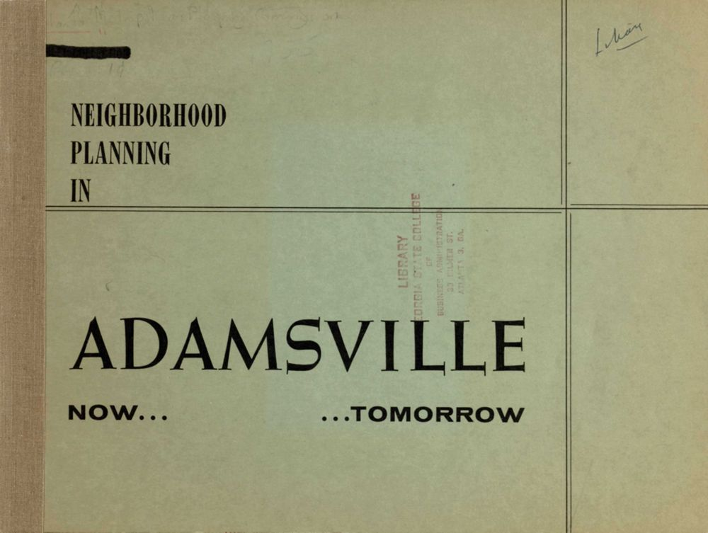
:::

The Civic Club's report was built around Margaret Fain School, which it called "the most important building in the community," the place for meetings, dinners and play (Adamsville Civic Club, 1955). The building is still standing, and from 2022 it housed Douglass High School's ninth-grade academy, and Atlanta Public Schools now plans to close it (Atlanta News First, 2022; Daniel, 2025).

::: {layout-ncol=2}
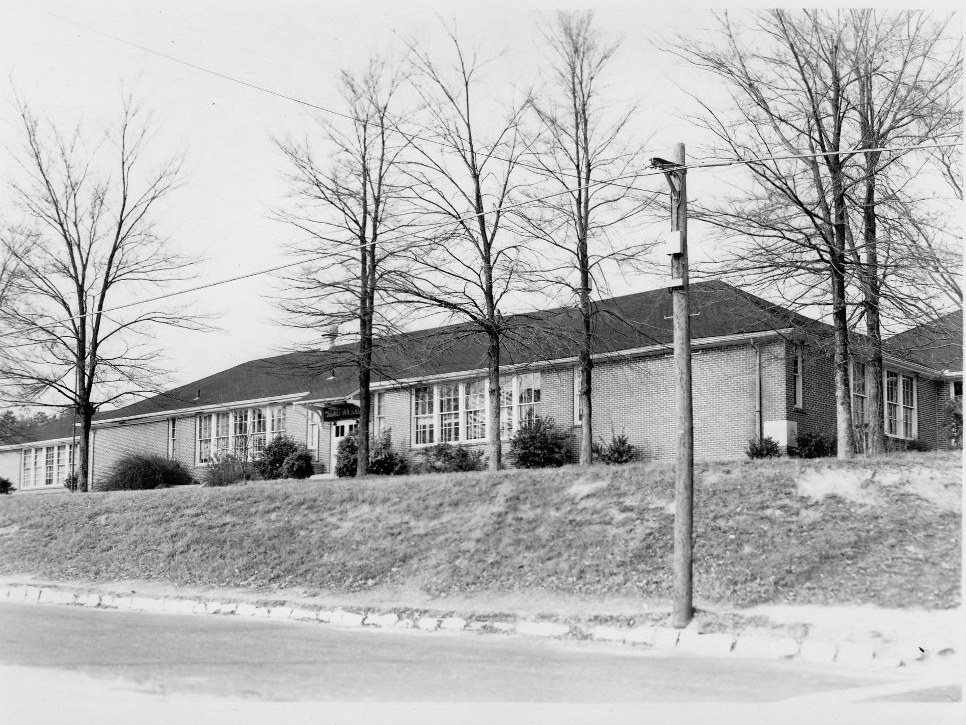{fig-alt="Black-and-white photo of a long one-story brick school behind bare trees on a grassy bank."}

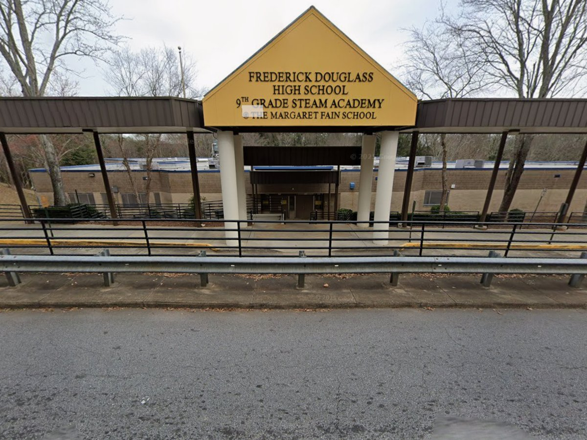{fig-alt="A covered walkway leading to a school entrance with a yellow sign."}
:::

The Civic Club's main requests in 1955 were:

- A shopping center grouped "at the crossroads of Fairburn and Gordon Roads," instead of stores strung along Gordon Road (p. 6).
- "Natural walkways" so children could reach schools and parks "without crossing trafficked streets" (pp. 5, 9, 11).
- Better bus service. The transit company's president agreed it was "inadequate" (p. 4).
- Sewers to replace septic tanks, with outflow lines along Sandy Creek and Utoy Creek (p. 13).
- A park: "There are no parks in Adamsville" (p. 10).
- Doctors and a drug store. None were within four miles, and the nearest hospital was nine miles away (p. 14).

The report credits Leon S. Eplan of the Metropolitan Planning Commission as "Adamsville Planner." This appears to be the same Leon Eplan who, as the city's commissioner of budget and planning, helped set up Atlanta's Neighborhood Planning Unit system in the 1970s (Banks, 2021; American Planning Association, 2021). If so, Adamsville's 1955 plan was an early example of the kind of resident-led planning that the NPU system later made citywide.

## Highways as boundaries

Postwar Atlanta used roads to manage racial change on the west side. Historian Ronald Bayor found that the city's Bureau of Planning, in a 1960 "Report on the Adamsville Transition Area," acknowledged an understanding that the planned west expressway would mark the line between white residents to the south and Black residents to the north. The city blocked Black developers from building south of the road, citing its "obligations to the Adamsville citizens to adhere to the expressway route boundary" (Bayor, 2001, pp. 71–81; see also Bayor, 1988). The Civic Club had already described the expressway as a "buffer" between industry and homes (1955, p. 7). In nearby Cascade Heights, Mayor Ivan Allen Jr. went further in December 1962, putting up a barricade on Peyton Road after white residents demanded a "racial buffer" against Black homebuyers. A court ordered it removed after 72 days (Carlisle, 2021).

As in Mozley Park and Cascade before it (Kruse, 2005; Gaither et al., 2016), white families in Adamsville sold and left anyway, and Black families, many of them middle-class, moved in through the 1960s and 1970s. Interstates 20 and 285 were built in the 1960s and meet at Adamsville. The I-285 exit sign still uses the neighborhood's name (City of Atlanta & TSW, 2020, p. 17).

## How residents tell this history

Resident B, a homeowner, heard from neighborhood leaders that the area "used to be really like flourishing," with "a lot of black wealth" and a high school that was "one of the most desirable" to attend, before wealth moved toward Smyrna, Marietta and the east side. Resident A talked more about newer landmarks, such as the C. T. Martin recreation center and the artists who grew up nearby. Neither of them knew about the 1950s planning, annexation or racial boundaries.

::: {.voice .b}
"I know that this community used to be really like flourishing. Black, a lot of black wealth was situated in this community."
<span class="who">Resident B, homeowner, interview, October 19, 2026</span>
:::

I do not think the archival record and the residents' accounts contradict each other. The records help explain how the Black middle-class Adamsville that residents remember came about, on land that had been planned and zoned around them and on the far side of an expressway the city had treated as a racial line. The road at the center of Adamsville now carries Dr. King's name, which links the neighborhood to the city's civil rights history. Downtown, the same road was once Hunter Street, where students marched on the State Capitol in 1960.

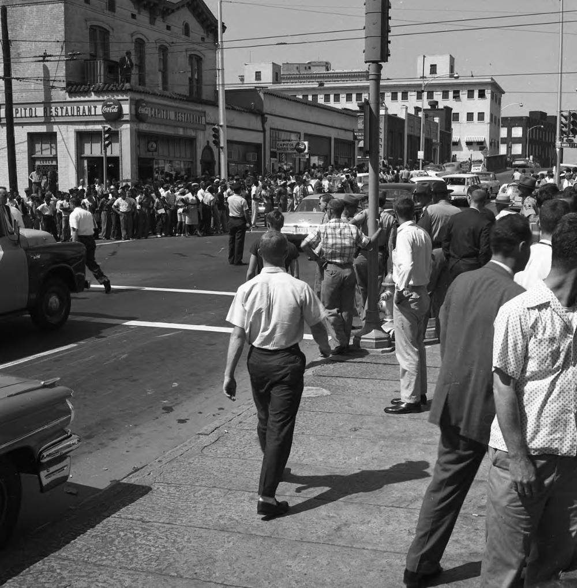{width=85%}

Today, the neighborhood's public memorials honor Black civic leaders. The 2023 "Adamsville Legacy" mural on MLK Jr. Drive by artist Ashley Dopson honors former council member C. T. Martin, State Senator Horace Tate, Rev. Dr. Gregory A. Sutton of Jackson Memorial Baptist Church, and Mayor Andre Dickens, who said at the unveiling, "This is home for me, I grew up right here" (Bunch, 2023).

## Timeline, 1864–2026

```{r timeline}
tl <- read_csv("data/timeline.csv", show_col_types = FALSE, col_types = cols(.default = "c"))
eras <- unique(tl$era)
tagList(lapply(eras, function(e) {
  rows <- filter(tl, era == e)
  tagList(
    div(class = "tl-era", e),
    lapply(seq_len(nrow(rows)), function(i) {
      r <- rows[i, ]
      div(class = "tl-ev",
          div(class = "yr", r$year),
          div(span(class = "tag", r$type), strong(r$title),
              p(r$text, style = "margin:.2rem 0"),
              span(class = "src", paste("Source:", r$source))))
    })
  )
}))
```

## One crossroads, four plans

Every major plan for Adamsville has named the same intersection, MLK Jr. Drive (formerly Gordon Road) at Fairburn Road, as the neighborhood's center.

::: {layout-ncol=2}
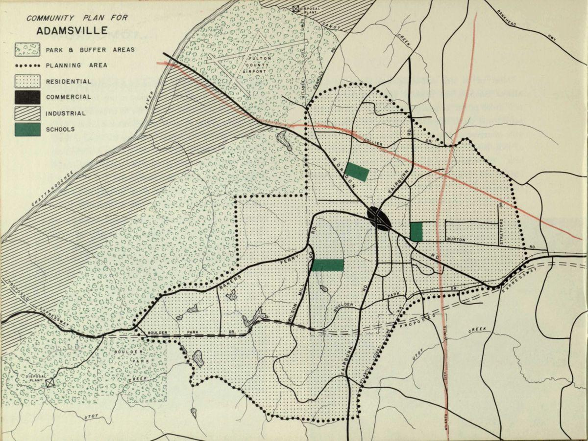

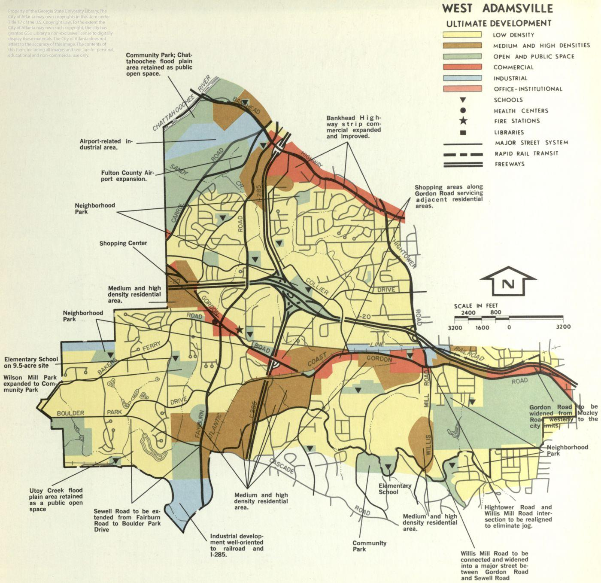

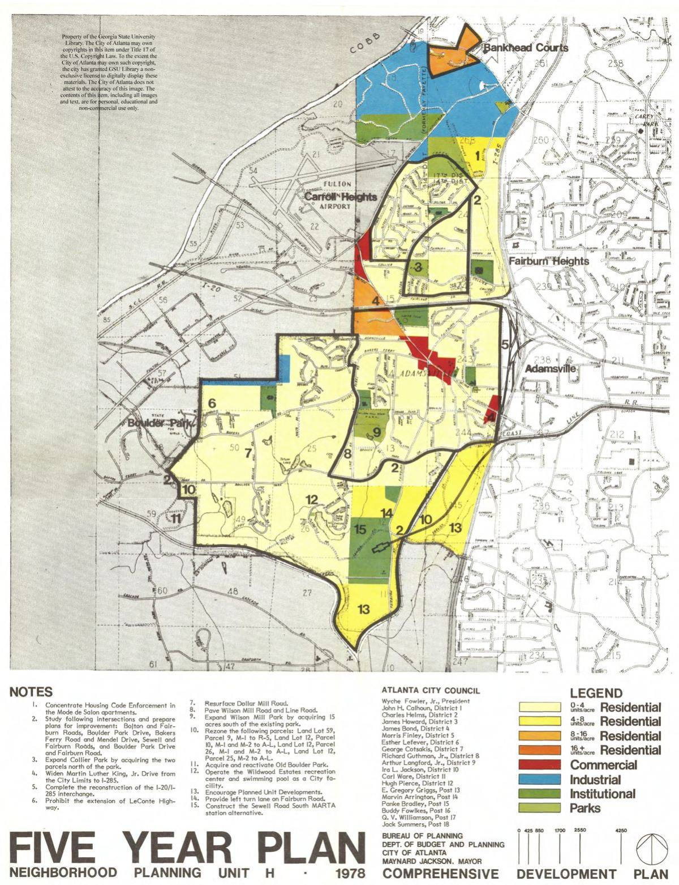

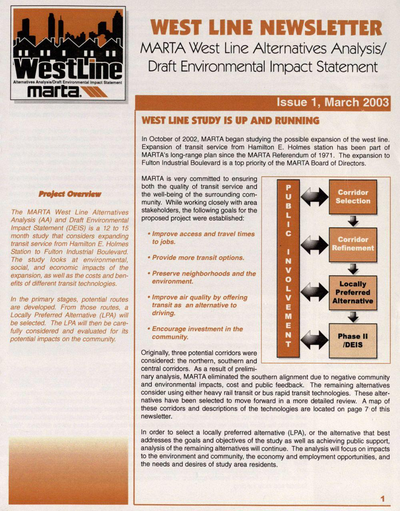
:::

In 2020 the NPU-H Master Plan again named the MLK–Fairburn intersection as a priority for "Adamsville Village": renovated apartments, senior housing and a civic green (City of Atlanta & TSW, 2020, pp. 72, 78, 90).

::: {.callout-important appearance="simple"}
## What stands at the crossroads in 2026

A Dollar General, City Takers church in a former commercial building, Fire Station 9, and the Atlanta Community Food Bank's free Community Food Center in a former Family Dollar at 3500 MLK Jr. Drive. No full-service grocery store is within walking distance. A long-time resident told reporters in 2025 that the closest one is five or six miles away (Peer, 2025; Invest Atlanta, 2025a).
:::

::: {layout-ncol=3}
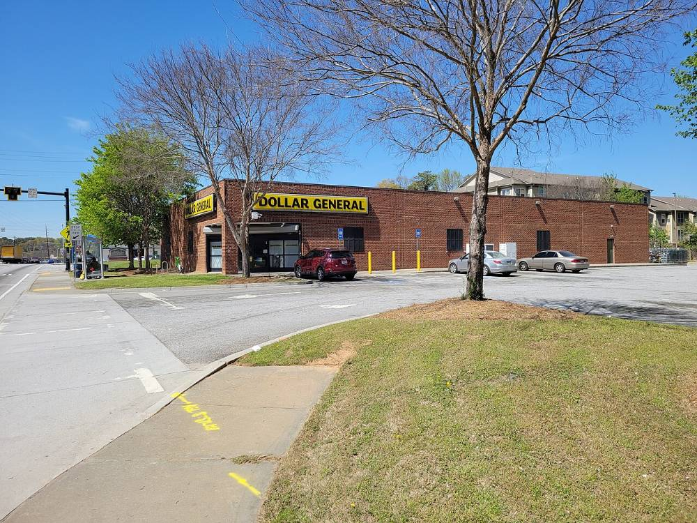

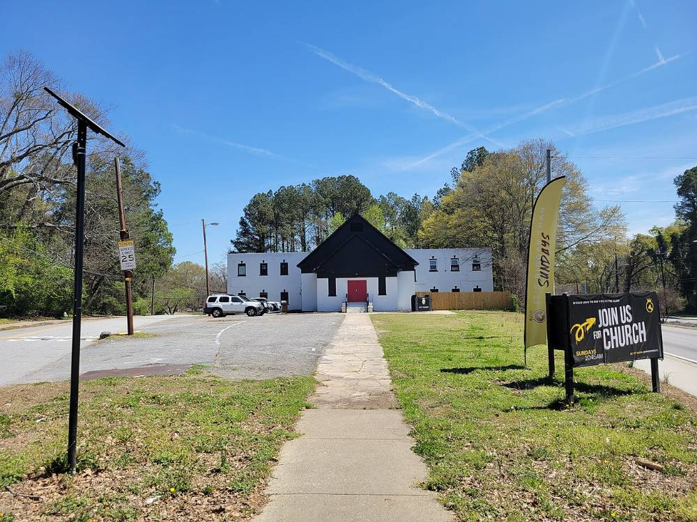

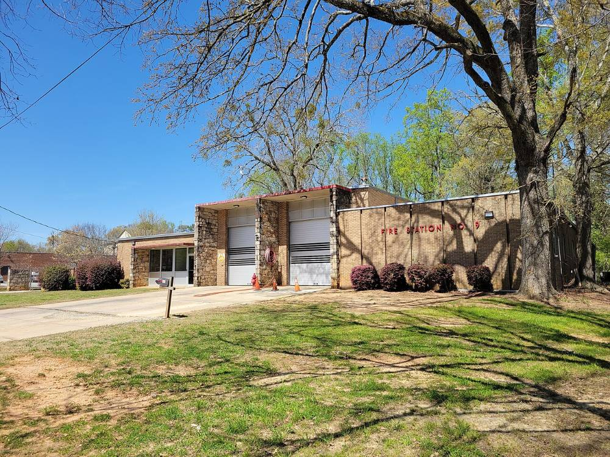
:::
