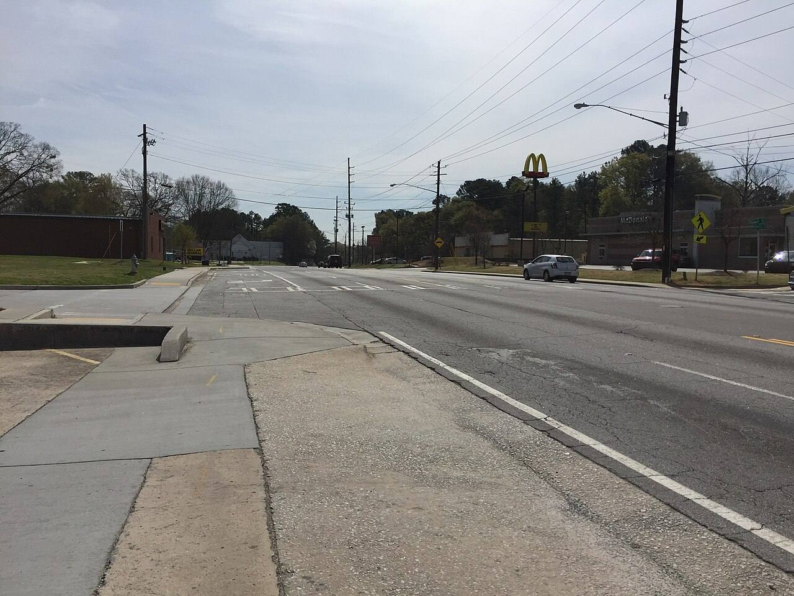

{fig-alt="A four-lane road with power lines and a fast-food sign in the distance."}

Since 1955, almost every plan for this west Atlanta neighborhood has focused on the same intersection. When I interviewed residents in 2026, much of what they said they still need was what their neighbors had already asked for in 1955.

## Why Adamsville, and why now

Adamsville sits where Martin Luther King Jr. Drive meets Fairburn Road, just inside Interstate 285 on Atlanta's west edge. The I-285 exit there is signed "Adamsville," and residents often use the name for a wider area than the city's official neighborhood boundary.

This case study is written for the people who make decisions about Adamsville: council staff, planners and agency managers. It draws on archival plans and maps, census data, scholarship, local news, and two in-depth interviews I conducted with Adamsville residents in October 2026. The interviewees are identified by role only (Resident A and Resident B) because they have not confirmed how they wish to be named.

What stood out to me most was how little the list of needs has changed. In 1955, a neighborhood civic club wrote its own plan asking for a shopping center at the crossroads, safe walking paths, better bus service, sewers and a park. The residents I interviewed in 2026 asked for a grocery store, sidewalks, working drainage, and some sign that going to meetings makes a difference.

::: {.callout-note appearance="simple"}
## Three findings for decision-makers

1. Plans in 1955, 1970, 1977 and 2020 all placed a town center at MLK Jr. Drive and Fairburn Road, but it was never built. Today the corner has a dollar store, a church in a former commercial building, a fire station, and a free food center in a former Family Dollar.
2. Census estimates show that NPU-H has a much larger share of children than Atlanta as a whole (28% vs. 17%). Even so, both residents described Adamsville as an aging neighborhood, and older residents' voices carry the most weight in meetings.
3. Problems with public causes, such as flooding, long bus commutes and missing sidewalks, end up being paid for by individual households through repair bills, lost time and personal risk.
:::

## What is in this case study

The case study has eight parts. The menu on the left stays on screen as you scroll, and every page ends with a link to the next part.

::: {.parts}
[**1 · Overview**<span>Why Adamsville, three findings, and a 13-stop map tour</span>](index.qmd)
[**2 · History**<span>From Lick Skillet to annexation, highways and racial change, 1864–2026</span>](history.qmd)
[**3 · Who lives here**<span>Census profile, age, poverty and renters, with a 2010 vs. 2024 swipe map</span>](people.qmd)
[**4 · Institutions and power**<span>Who holds power, their incentives, and who is left out</span>](institutions.qmd)
[**5 · Everyday life**<span>Rhythms, anchors, norms and getting around</span>](everyday.qmd)
[**6 · Issues residents face**<span>Fresh food, keeping a home, safe streets</span>](issues.qmd)
[**7 · Recommendations**<span>Five actions for the City of Atlanta</span>](city.qmd)
[**8 · Methods and sources**<span>Interviews, data, AI-use statement and references</span>](sources.qmd)
:::

<!-- YOUR VOICE: add 2-3 sentences in your own words on why you chose Adamsville
(for example, what you learned about it during your internship with Partnership
for Southern Equity, and what surprised you on your field visit). -->

## Thirteen places that explain Adamsville

A guided tour, in the style of an ArcGIS StoryMap map tour. Use **Next** and **Back**, click a numbered marker, or pick a stop from the strip below the map. Switch between street, gray and satellite basemaps with the layer button at the top right of the map. The dashed outline is Neighborhood Statistical Area H02 (Adamsville and Oakcliff), the area the city uses for census statistics.

```{r tour-data}
#| output: asis
places <- read.csv("data/places.csv", stringsAsFactors = FALSE)
cat("<script>window.PLACES = ", jsonlite::toJSON(places, dataframe = "rows"), ";</script>\n", sep = "")
cat("<script>window.NSA = ", paste(readLines("data/nsa_h02.geojson", warn = FALSE), collapse = ""), ";</script>\n", sep = "")
```

```{=html}
<link rel="stylesheet" href="https://unpkg.com/leaflet@1.9.4/dist/leaflet.css">
<script src="https://unpkg.com/leaflet@1.9.4/dist/leaflet.js"></script>
<div class="tour">
  <div class="tour-panel">
    <div class="tour-media"><div id="tour-noimg">No public photograph of this place is available. Switch the map to Satellite to see it from above.</div></div>
    <div class="tour-body">
      <div class="tour-count" id="tour-count"></div>
      <h3 id="tour-title"></h3>
      <p id="tour-text"></p>
      <p class="tour-cap" id="tour-cap"></p>
      <div class="tour-nav"><button id="tour-prev" type="button">&larr; Back</button><button id="tour-next" type="button">Next &rarr;</button></div>
    </div>
  </div>
  <div id="tour-map"></div>
</div>
<div class="tour-strip" id="tour-strip"></div>
<script>
(function(){
  var P = window.PLACES, colors = {Commercial:"#d2493c", Civic:"#4f8fb4", Recreation:"#b8901c", Service:"#6f9a7c", Housing:"#7a4fb4"};
  var streets = L.tileLayer("https://tile.openstreetmap.org/{z}/{x}/{y}.png", {maxZoom: 19, attribution: "&copy; OpenStreetMap contributors"});
  var gray = L.tileLayer("https://services.arcgisonline.com/ArcGIS/rest/services/Canvas/World_Light_Gray_Base/MapServer/tile/{z}/{y}/{x}", {maxZoom: 16, attribution: "Esri, HERE, Garmin, OpenStreetMap contributors"});
  var sat = L.tileLayer("https://server.arcgisonline.com/ArcGIS/rest/services/World_Imagery/MapServer/tile/{z}/{y}/{x}", {maxZoom: 19, attribution: "Esri, Maxar, Earthstar Geographics"});
  var map = L.map("tour-map", {layers: [streets], scrollWheelZoom: false}).setView([33.757, -84.505], 14);
  L.control.layers({"Streets": streets, "Gray": gray, "Satellite": sat}).addTo(map);
  L.geoJSON(window.NSA, {style: {color: "#c2412f", weight: 3, dashArray: "8 6", fillColor: "#e9c74f", fillOpacity: 0.15}}).addTo(map);
  var markers = P.map(function(p, i){
    var icon = L.divIcon({className: "tour-pin", html: '<span style="background:' + (colors[p.type] || "#333") + '">' + p.id + "</span>", iconSize: [30, 30], iconAnchor: [15, 15]});
    return L.marker([p.lat, p.lon], {icon: icon, title: p.name}).addTo(map).on("click", function(){ show(i); });
  });
  var strip = document.getElementById("tour-strip");
  P.forEach(function(p, i){
    var b = document.createElement("button"); b.type = "button"; b.innerHTML = "<b>" + p.id + "</b> " + p.name;
    b.style.borderLeftColor = colors[p.type] || "#333"; b.onclick = function(){ show(i); }; strip.appendChild(b);
  });
  var cur = 0;
  function show(i){
    cur = (i + P.length) % P.length; var p = P[cur];
    document.getElementById("tour-count").textContent = "Stop " + p.id + " of " + P.length + " \u00b7 " + p.type;
    document.getElementById("tour-title").textContent = p.name;
    document.getElementById("tour-text").textContent = p.note;
    var img = document.getElementById("tour-img"), no = document.getElementById("tour-noimg");
    if (p.image) { img.src = p.image; img.alt = p.caption; img.hidden = false; no.hidden = true; document.getElementById("tour-cap").textContent = p.caption; }
    else { img.hidden = true; no.hidden = false; document.getElementById("tour-cap").textContent = ""; }
    markers.forEach(function(m, j){ m.getElement() && m.getElement().classList.toggle("on", j === cur); });
    [].forEach.call(strip.children, function(c, j){ c.classList.toggle("on", j === cur); });
    map.flyTo([p.lat, p.lon], 16, {duration: 0.8});
  }
  document.getElementById("tour-prev").onclick = function(){ show(cur - 1); };
  document.getElementById("tour-next").onclick = function(){ show(cur + 1); };
  show(0);
})();
</script>
```

*Boundary: Atlanta Regional Commission. Locations geocoded with the ArcGIS World Geocoding Service. Basemaps: OpenStreetMap contributors; Esri.*
