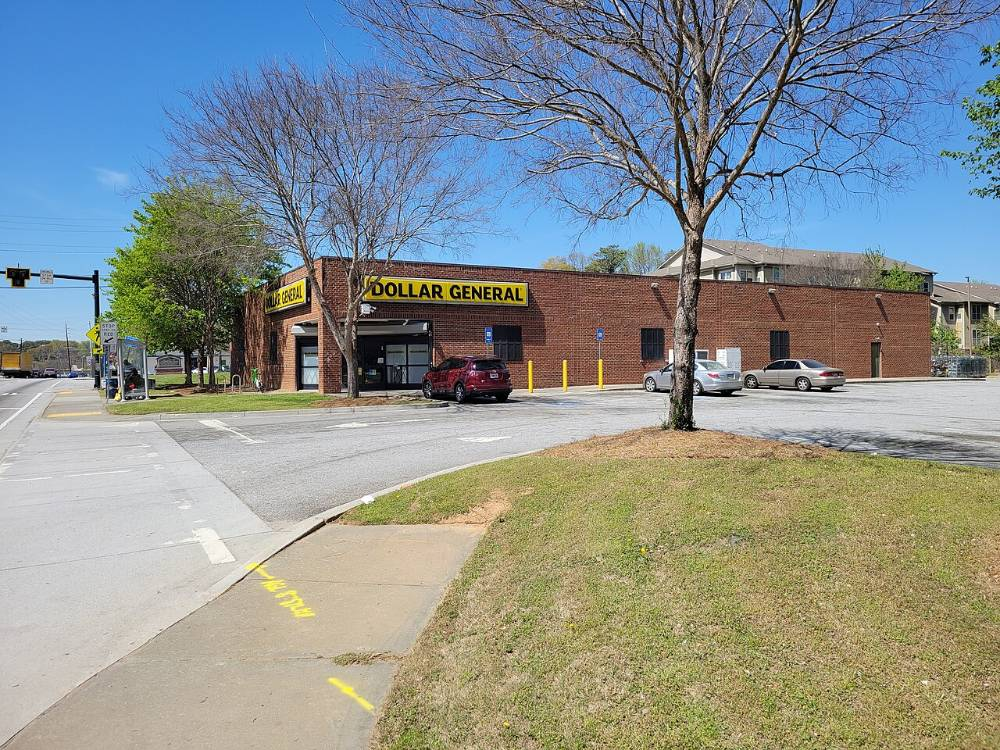

I chose these three issues because they came up repeatedly in both interviews and are also documented in public records. For each one, I describe what is happening now, its history in Adamsville, where residents disagree, and what makes it specific to this neighborhood.

::: {.panel-tabset}

## Fresh food

#### Current situation

The 2020 master plan classifies NPU-H as a "low income, low access" food area (City of Atlanta & TSW, 2020, p. 42). In August 2025 the Atlanta Community Food Bank opened its first in-city Community Food Center in a former Family Dollar at 3500 MLK Jr. Drive. It serves more than 700 families a month by appointment (Invest Atlanta, 2025a; Andrews, 2025). The food bank's CEO said food insecurity is "really concentrated" in Adamsville (Peer, 2025).

#### Background

The lack of a commercial center at the crossroads has been documented for about seventy years.

| Year | Evidence |
|---|---|
| 1955 | No drug store within 4 miles; the Civic Club proposes a shopping center at the crossroads |
| 1970 | City map marks "Shopping Center" at Gordon and Fairburn Roads |
| 2010 | 911 residents surveyed say they feel like "a forgotten community" (City of Atlanta & TSW, 2020, p. 118) |
| 2019 | Survey's top reason for not walking: "needed services are too far away" (City of Atlanta, 2020, p. 63) |
| 2025 | Free food center opens; the NPU chair says Adamsville has lost many food stores (Andrews, 2025) |

#### Where residents disagree

Resident A welcomes the pantry as "accessible" but notes "it's not necessarily fresh food," and sees the community garden and marketplace as the answer. Resident B wants private investment: "We deserve a Sprouts. We deserve a Whole Foods." She calls it "a chicken or egg thing": stores wait for the neighborhood to improve, and the neighborhood waits for stores.

#### What is specific to Adamsville

The food shortage in Adamsville is long-standing rather than the result of one store closing. The crossroads has been planned as a commercial center since 1955, but it has never had the population density or buying power that grocers look for, and a quarter of households do not have a car. The food center meets an emergency need, but neither its operator (a charity) nor its funding (a TAD grant) is set up to bring in a grocery store.

{width=80%}

## Keeping a home

#### Current situation

Resident B's lakeside street floods "every time there's a flash flood warning, our basements flood." She has spent "upwards of $50,000" on floors, mold prevention and French drains that "do nothing" because no one checked the foundation. Resident A sees homes renovated and listed for rent or as Airbnbs. In NPU-H, 57 percent of renters and 45 percent of owners with mortgages are cost-burdened (ACS 2020–2024).

#### Background

Adamsville sits on a ridge that drains to Sandy Creek and Utoy Creek. In 1955 homes still relied on septic tanks, and the Civic Club asked for sewers along those creeks. Many subdivisions were built quickly in the 1950s and 1960s (City of Atlanta & TSW, 2020, p. 17). One master plan goal is to minimize flooding by keeping natural terrain and using stormwater best practices (p. 9), and the city and the U.S. Army Corps of Engineers have begun a Utoy Creek ecosystem study (Atlanta Department of Watershed Management, 2023). Low prices relative to the city ($214,316 median value against $439,600) make the area attractive to investors who target majority-Black neighborhoods (An, 2023; Hansen, 2023).

#### Where residents disagree

Resident B sees new construction as "promising" and wants "newer renovations on the houses." Resident A worries about the "historical economic aftermath": rising costs push original residents out and "developers come in." She notes investors are "not moving in. They're just redoing the homes and putting them up for rent."

#### What is specific to Adamsville

In Adamsville, the pressure on residents to leave comes from many small costs adding up rather than from a single redevelopment project. Older owners face flood repairs and rising taxes, renters face investor landlords, and some houses become short-term rentals that Atlanta's 2021 permit rules, enforced mainly on complaint, barely reach (Capelouto, 2022). Fried (1966) and Fullilove (2016) describe the grief of losing a familiar place, or "root shock." In Adamsville, that kind of loss could happen gradually, one house at a time, without any single institution being responsible for noticing it.

## Safe streets

#### Current situation

Resident B hears gunshots at night and avoids the Fairburn Road corridor; a stray bullet hit her family's car on the way home from the library. The 2019 master plan survey found crime, gunfire and poor street lighting on major roads to be top quality-of-life concerns (City of Atlanta & TSW, 2020, pp. 57–59). Resident A sees a milder picture of mostly youth property crime: "breaking windows, like trying to break into cars."

#### Background

The 1955 report already warned that fast traffic made service streets "unsafe to walk on or to cross" (p. 4). Interstates and wide state routes were built through the area after that. In neighboring Cascade, researchers found sidewalks "disappear" in the western sections and that crime shapes where residents walk (Gaither et al., 2016). Resident B says Adamsville's street and pedestrian lights "aren't as good as the ones in the white neighborhoods." The master plan asks the city to prioritize lighting on MLK, Benjamin E. Mays and Fairburn (p. 74).

#### Where residents disagree

Resident B links violence to poverty and to having "not much to do out here." Resident A sees youth programs and gardens as prevention and calls for a neighborhood watch. Both connect safety to walkability, and Resident B's first wish for the next ten years is "sidewalks… more walkable, more family friendly."

#### What is specific to Adamsville

Residents' fear is tied to particular corridors (Fairburn Road and the park at Fairburn and Benjamin E. Mays) and to streets without sidewalks, where walking means being in the roadway. Closing the ninth-grade campus in the old Fain building will remove one of the few structured daytime places for teenagers near the crossroads.

:::
